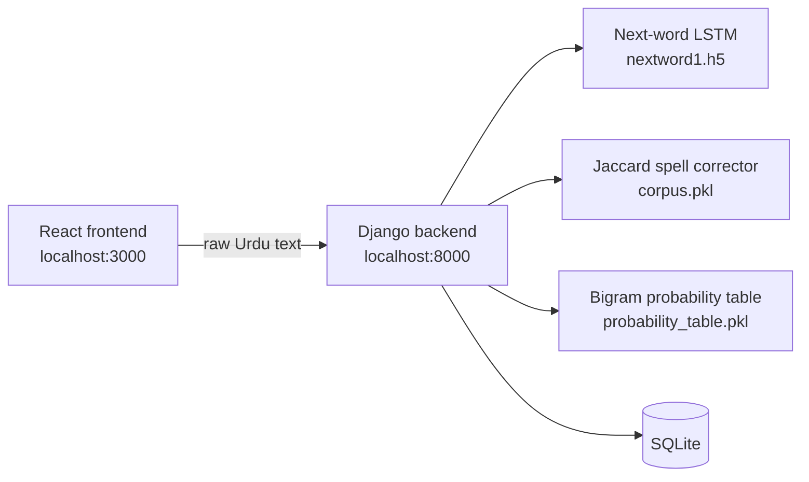

# Urdu Grammarly

**An AI-powered writing assistant for Urdu.** It predicts the next word as you type, corrects misspelled words, and scores sentence grammar, all served through a Django REST backend and a React web app.

Urdu Grammarly brings the experience of tools like Grammarly to Urdu, a language with few writing aids. It combines a recurrent neural network (LSTM) for next-word prediction, a Jaccard-distance spell corrector, and an n-gram probability model for grammar scoring.

## Features

- **Next-word prediction:** an LSTM model suggests the most likely next words from the last few words typed.
- **Spelling correction:** misspelled words are matched against a corpus of correct Urdu words using character-bigram Jaccard distance, and the app reports how many words are correct and incorrect.
- **Grammar scoring:** sentences are tokenized and scored with a bigram probability table built from the training data.
- **Web interface:** React pages for the writing and suggestion screens, plus About, Contact, Login and Sign Up.
- **User accounts:** token-based authentication with Django REST Framework.

## Architecture



## Tech Stack

| Layer | Technologies |
| --- | --- |
| Machine learning | TensorFlow, Keras, LSTM, NLTK, NumPy |
| Backend | Python, Django, Django REST Framework |
| Frontend | React, React Router, Ant Design, Axios, ApexCharts |
| Storage | SQLite, pickled model artifacts |

## API Endpoints

All NLP endpoints accept a plain-text request body and return JSON.

| Method | Endpoint | Purpose | Response |
| --- | --- | --- | --- |
| `POST` | `/prediction` | Predict the next word from the last words typed | `{"result": [...]}` the top predicted words |
| `POST` | `/correction` | Correct spelling of each word in the text | `{"cor_result", "input_Correct", "input_Incorrect"}` |
| `POST` | `/grammar` | Score the grammatical likelihood of the text | `{"gram_result"}` |
| `POST` | `/auth/` | Obtain an auth token for a user | `{"token"}` |
| `GET`, `POST` | `/api/users/` | List or create users | User objects |

## Getting Started

### Prerequisites

- Python 3.10 (the bundled `.pyc` files were built with it)
- Node.js 14 or later and npm
- [Git LFS](https://git-lfs.com/)

### 1. Clone and fetch the model files

The trained models (`nextword1.h5` and the `.pkl` artifacts) are stored with Git LFS. Pull them before running the backend:

```bash
git clone https://github.com/arslanahmad768/Urdu-Grammarly.git
cd Urdu-Grammarly
git lfs install
git lfs pull
```

### 2. Run the backend

```bash
pip install django djangorestframework tensorflow nltk numpy
python -c "import nltk; nltk.download('punkt')"
python manage.py migrate
python manage.py runserver
```

The API runs at `http://127.0.0.1:8000`.

### 3. Run the frontend

In a second terminal:

```bash
cd frontend
npm install
npm start
```

Open `http://localhost:3000` in your browser.

## Project Structure

```
Urdu-Grammarly/
├── Grammar/             # Django app: views, serializers, routes for the API
├── UrduGrammarly/       # Django project settings and root URL configuration
├── frontend/            # React app (screens, components, styles, images)
├── nextword1.h5         # LSTM next-word prediction model (Git LFS)
├── tokenizer1.pkl       # Tokenizer for the LSTM model (Git LFS)
├── corpus.pkl           # Vocabulary used for spelling correction (Git LFS)
├── probability_table.pkl, distinct_tokens.pkl, dct.pkl, dict1.pkl
│                        # Bigram statistics used for grammar scoring (Git LFS)
└── manage.py
```

## Author

**Arslan Ahmad**: [GitHub](https://github.com/arslanahmad768)
